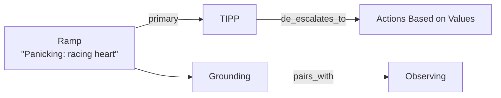

# dbt_me

[](https://github.com/micleners/dbt_me/actions/workflows/validate.yml)

**A typed knowledge graph of DBT skills that you navigate from how you feel to what you can do about it.**

DBT (Dialectical Behavior Therapy, Marsha Linehan's framework) teaches four skill modules: Mindfulness, Distress Tolerance, Emotion Regulation, and Interpersonal Effectiveness. Most DBT apps treat those skills as a reference manual or a checklist. This project models them as a graph instead: you enter from a felt state, a situation, or a goal, then follow typed links to a concrete skill and the reason it fits.

> [!NOTE]
> This is a personal reference project, not medical advice or a substitute for treatment. Skill content is paraphrased from [dialecticalbehaviortherapy.com](https://dialecticalbehaviortherapy.com), and each page links back to its source.

## At a glance

| | |
|---|---|
| Pages (nodes) | 48 across all four modules |
| Typed edges | 181, each with a required `note` explaining why it exists |
| Entry ramps | 32 felt states, situations, and goals |
| Dependencies | None: one Python script validates and indexes the graph |

## How it works



1. **Ramps** (`ramps.yaml`) match how people actually arrive: "panicking", "conflict with a person", "I want to ask for something". Each ramp points at a primary skill plus alternatives.
2. **Pages** (`pages/<module>/*.md`) are one skill each: YAML frontmatter for the node and its outgoing edges, Markdown body for the practice itself.
3. **Edges** carry one of nine relations (`escalates_to`, `de_escalates_to`, `builds_on`, `prerequisite_of`, `part_of`, `alternative_to`, `contrasts_with`, `pairs_with`, `if_condition`), so a client can explain *why* it suggests the next skill, not just *that* it does.
4. **The build** (`build.py`) validates the graph and generates `backlinks.json`, a reverse index that lets clients traverse in both directions.

The data is the product. A chat agent is the crawler today; a web app can render the same files later without changing them. The full model is in [`SCHEMA.md`](SCHEMA.md).

## Quickstart

```sh
git clone git@github.com:micleners/dbt_me.git
cd dbt_me
python build.py           # validate the graph and regenerate backlinks.json
python build.py --check   # validate only; fail if backlinks.json is stale (what CI runs)
```

The build fails on any edge or ramp that points at a missing page, or any page outside the 3–6 outgoing-edge guardrail. Fewer than three edges means an orphaned page; more than six means a page that should be split.

## Repository layout

```
SCHEMA.md                     data model: pages, typed edges, ramps, guardrails
build.py                      validator and backlinks.json generator (stdlib only)
ramps.yaml                    entry ramps into the graph
backlinks.json                generated reverse index (never hand-edited)
pages/<module>/               one skill per file: node, edges, and practice
raw/<module>/                 cached source summaries the pages are distilled from
supplemental_dbt_flashcards/  notes on a physical DBT flash card deck, not yet in the graph
methodology/                  backlog, design proposals, and investigations
validation/                   external research validating the data model
.claude/skills/               agent workflows for guided conversations and card ingestion
```

## How the content is maintained

- **Source fidelity.** Pages keep every step, its order, and any durations from the source, and add no claims of their own. Our own connections and commentary live only in edge notes and `## Notes` sections.
- **Two-layer content.** `raw/` caches each source page once; `pages/` distills it into the graph.
- **Validated on every push.** GitHub Actions runs `python build.py --check`, so a broken link or a stale index can't land on `main`.
- **Agent-assisted, human-directed.** Authoring and conversation workflows are written as Claude Code skills in `.claude/skills/`, with project conventions in [`CLAUDE.md`](CLAUDE.md).
- **Decisions tracked in the open.** Open design questions (edge caps for cross-module links, scenario testing, deck integration) live in [`methodology/system_enhancement.md`](methodology/system_enhancement.md).

## Status

All four modules are built. Per-module counts live in [`CLAUDE.md`](CLAUDE.md). Next up: integrating the flash card deck into the graph and adding scenario tests that check real situations still route to sensible skills.

## License

Copyright © 2026 Michael Leners. All rights reserved. No license is granted to copy, modify, or redistribute this repository. DBT skill content belongs to its original authors; see each page's `source_url`.
